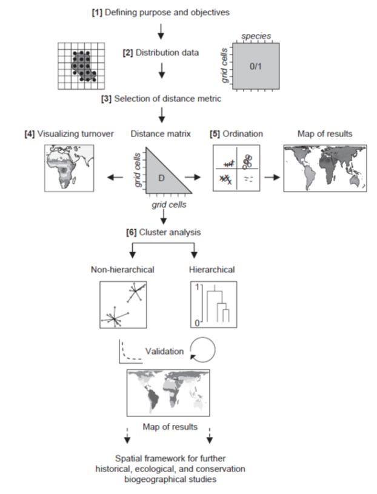

  
# Introduction
  
Nous allons ici suivre le cadre méthodologique de Kreft & Jetz 2010 (J. Biogeogr.) pour analyser la diversité beta et rechercher des ensembles biogéographiques. Le TP suit donc globalement ce cadre :

On va travailler sur les régions biogéographiques des araignées de l'Ouest-Paléarctique. Les données proviennent directement du GBIF ([GBIF Occurrence Download, https://doi.org/10.15468/dl.aymym7](https://doi.org/10.15468/dl.aymym7)), et je n'ai appliqué que des règles simples de filtration pour le moment :

- occurrences des araignées (Araneae) dans l'Ouest-Paléarctique 

- seulement les données avec coordonnées et sans problème géospatial signalé par le GBIF

- occurrences de 1970 à aujourd'hui, avec une incertitude sur les coordonnées inférieure à 10 km (ou non renseignée), en excluant les fossiles et les spécimens vivants en collection

- identifications au rang de l'espèce uniquement (les sous-espèces sont regroupées dans leur espèce, les identifications au genre ou à la famille sont retirées)

Les occurrences ont ensuite été agrégées sur une grille de cellules de 100 km x 100 km (projection équivalente en surface LAEA Europe), en ne conservant que les cellules terrestres, puis transformées en matrice de présence-absence.

L'objectif va être de trouver la structure biogéographique des araignées de l'Ouest-Paléarctique en apprenant comment utiliser le clustering sur la diversité beta. Ce sera l'occasion de découvrir que la méthode est très sensible à la qualité des données, et va vous demander de filtrer le jeu de données pour obtenir des résultats corrects.

# Chargez les packages

Pour ce TP vous avez besoin de deux packages : `bioregion` (calcul de diversité beta et classification) et `sf` (manipulation d'objets spatiaux).

# 1. Chargement des données

Téléchargez les données:

- [Matrice de présence-absence](https://github.com/Farewe/Cours_Bioregionalisation/raw/master/data/araignees/araignees_wp_100km_comat.RDS)

- [Localisation des sites (grille)](https://github.com/Farewe/Cours_Bioregionalisation/raw/master/data/araignees/araignees_wp_100km_sites.RDS)

Chargez la matrice de présence-absence et la localisation des sites en utilisant la commande `readRDS()`. 

## Calcul de la richesse spécifique et filtrage des données

Calculez la richesse spécifique à partir de la matrice présence - absence. Comment faire ? Demandez-vous : que signifie la somme des lignes sur la matrice ? Que signifie la somme des colonnes ? Et donc, comment calculer la richesse ?

## Inspection des données : richesse et effort d'échantillonnage 

Une fois que vous avez calculé la richesse manuellement, inspectez votre objet des sites. Vous constaterez qu'il contient déjà la richesse calculée (vérifiez sur les premiers sites que vos calculs sont bons !), ainsi que d'autres infos, notamment le nombre d'occurrences totales, qui est un indicateur de l'effort d'échantillonnage. 

Faites deux cartes :

- la carte de la richesse spécifique

- la carte de l'effort d'échantillonnage

**Question** Que constatez-vous ?

## Filtrez le jeu de données

Créez une copie de la matrice de co-occurrence et des sites en éliminant toutes les cellules à richesse inférieure à 50 (e.g., appelez les `comat_50` et `sites_50`). Vous ferez toutes les analyses suivantes sur ces deux jeux de données en parallèle, afin de voir la différence entre données filtrées et non filtrées.

Comment filtrer un jeu de données ? Il faut donner une condition.

Supposons que `comat` aient les sites ordonnées de la même manière que la richesse calculée `richness` (c'est normalement le cas si vous avez calculé la richesse comme il faut). Dans ce cas, si vous faites `richness > 50`, vous obtenez des valeurs TRUE (si la richesse est supérieure à 50) et FALSE (si la richesse est inférieure ou égale à 50) pour chaque site. Et donc, si vous faites `comat[richness > 50, ]`, vous n'allez garder que les lignes de comat dont la richesse est supérieure à 50. 

# 2. Calcul des distances entre bassins avec l'indice ßsim [3]

$$ \beta_{sim}= 1 - \frac{a}{min(b,c)+a}$$

où a = nombre d'espèces partagées entre les deux sites; b et c = nombre d'espèces uniques à chacun des deux sites

Fonction `dissimilarity()` du package `bioregion`

# 3. Visualisation des distances entres sites (facultatif)

Etant donné que le jeu de données est assez gros, on va se contenter de la méthode de la 'cellule focale' pour visualiser les distances. 

Pour ce faire :

- transformez les distances qui sont au format data.frame en format matrice. Utilisez `net_to_mat()` pour ça, en précisant que vous gardez bien les poids, et que la matrice doit être carrée et symétrique.

- prenez une cellule au hasard (par exemple en faisant la commande `sample()` qui fait un tirage aléatoire, tirez UN SEUL SITE)

- ne prenez que les éléments de la matrice des distances qui correspondent à votre cellule focale. Comment faire ça ? 
  
  - filtrez la matrice pour ne garder qu'une seule ligne, celle qui correspond à votre cellule focale.

  - gardez toutes les colonnes, mais **dans l'ordre des sites de votre objet `sites`**, pour que chaque distance tombe sur la bonne cellule.

  - astuce : les lignes et colonnes de la matrice sont nommées avec les identifiants des sites. Vous pouvez donc filtrer avec `matrice[ligne, colonnes]` en utilisant ces noms, convertis en texte avec `as.character()`.

- stockez le résultat dans une nouvelle colonne de `sites` (par exemple `focal_dist`), puis cartographiez-la avec `plot()`

Si vous galérez trop, sautez cette étape pour le moment, c'est moins important. C'est de la difficulté de programmation, ce n'est pas l'essentiel ici. Quand vous aurez le corrigé vous aurez le loisir de revoir ces lignes en détail.

# 4. Faire la classification ascendante hiérarchique 

Réaliser une classification ascendante hiérarchique avec la méthode UPGMA [6]. Etant donné que l'ordre des sites influence la classification, il faut faire de nombreux arbres rééchantillonnant de nombreuses fois les noms des sites aléatoirement, et sélectionner le meilleur arbre, comme vu pendant le cours.

Le problème, que si on génère plein d'arbres aléatoirement à partir de la même matrice en changeant juste l'ordre des sites, comment on choisit le meilleur ? Plusieurs méthodes :

- en prendre un au pif (je ne vous le recommande pas, mais c'est techniquement ce qui est fait par de nombreux papiers qui ne vérifient pas l'effet de l'ordre des sites...)

- choisir le meilleur, avec le **coefficient de corrélation cophénétique**, qui vous dit à quel point la hauteur des noeuds qui relient les sites dans l'arbre est similaire à la distance entre sites dans la matrice initiale (relisez autant de fois qu'il faut cette phrase pour la comprendre ! Faites vous un petit schéma si ça peut vous aider à comprendre). C'est une bonne approche, mais ce n'est pas la meilleure. Elle est très bien pour des analyses rapides et pour des tests.

- créer un arbre consensus en utilisant les méthodes des phylogénies. **Ca marche très très mal et je ne vous recommande pas cette approche.** Vous obtiendrez souvent un grand rateau qui relie tous les sites au sommet de l'arbre, sans structure hiérarchique.

- construire l'arbre du haut vers le bas, en recherchant la meilleure division en branches parmi un grand nombre d'arbres aléatoires. C'est un processus itératif, qui ré-échantillonne les sites restants dans la matrice de distance à chaque nouvelle découpe de l'arbre, permettant de prendre la décision majoritaire à chaque fois. **Je vous recommande cette approche, qui donne les meilleurs résultats.** 

Pour cela, utilisez la fonction `hclu_hierarclust()` du package `bioregion`. Choisissez la méthode que vous préférez tester avec `optimal_tree_method`.

Regardez le coefficient de corrélation cophénétique de l'arbre final, et comparez entre le jeu de données filtré et le non filtré.

Affichez l'arbre avec `plot()`. 

# 5. Evaluer la qualité de la classification consensus

Quelle est la valeur du coefficient cophénétique de votre arbre ? Que vous dit cette valeur ? Cette valeur indique à quel point l'arbre hiérarchique représente fidèlement les distances originales entre sites. Plus elle est proche de 1, meilleure est la représentation.

**Question** Quelles conséquences sur la qualité de l'arbre de filtrer le jeu de données ?

# 6. Rechercher la hauteur à laquelle couper l'arbre

Pour identifier une partition dite 'optimale' sur un arbre, il faut le découper de nombreuses fois (chaque découpe est appelée une partition), et analyser comment les partitions se comportent par rapport à des métriques d'évaluation. On va commencer par un découpage assez haut dans l'arbre, et donc on va regarder des nombres de clusters limités au début, on analysera comment le découpage se comporte **entre 2 et 50 clusters maximum.**

Pour cet exercice je vous propose d'utiliser la métrique de Holt et al. 2013, qui consiste à comparer la "dissimilarité expliquée par les clusters" (= somme des dissimilarités entre sites qui appartiennent à des clusters différents) à la dissimilarité totale (= somme des dissimilarités de la matrice de distance initiale). En gros, on élimine du calcul toutes les distance intra-cluster, et on ne regarde que les distances inter-clusters.

On va procéder comme ceci :

(1) on découpe l'arbre de nombreuses fois, allant de 2 à 50 clusters

(2) pour chaque découpe, on calcule la métrique de dissimilarité entre clusters

(3) on fait un graphe métrique ~ nombre de clusters

(4) on prend une décision, soit arbitraire, soit en utilisant une méthode

## Etape 1

Utilisez la fonction `cut_tree()` et spécifiez que vous voulez de 2 à 50 clusters. Cela vous donnera un objet en sortie qui contient 49 partitions. 

## Etape 2

Calculez la métrique sur chaque partition avec la fonction `bioregionalization_metrics()`. Choisissez bien de calculer la métrique de Holt et al. 2013.

## Etape 3 et 4 (on fait les deux ensemble)

Faites le graphe et choisissez un critère d'optimisation. Je vous propose de commencer par une méthode simple, regarder là où on a le plus grand "saut" dans la métrique, et couper l'arbre à ce niveau. Concrètement, ça veut dire regarder la différence entre chaque découpe, et ne retenir que là où la différence est la plus élevée. 

Pour faire ça, utilisez `find_optimal_n()`, et utilisez le critère `increasing_step`, avec un seuil qui s'assure que vous ne retenez que la différence la plus élevée (e.g., `step_quantile = 0.99`)

**Question**
Combien de clusters pour chaque arbre ? A quelle hauteur l'arbre a-t-il été coupé ?

# 7. Faire la carte des clusters obtenus

Commencez par attribuer des couleurs à vos clusters automatique avec la fonction `bioregion_colors()`. Ensuite, créez la carte des régions avec `map_bioregions()`, comme dans le TP sur les réseaux, le fonctionnement est identique !

Décrivez le résultat que vous obtenez : 

- Semble-t-il y avoir différents clusters ?

- Comment sont-ils distribués ? 

- Fallait-il filtrer ou non le jeu de données pour éliminer les cellules à faible richesse ? Pourquoi ?

# 8. Si vous avez fini en avance : 

Comparez avec la méthode des réseaux, sur les jeux filtrés et non filtrés.

Qu'en pensez-vous ? La méthode des réseaux gère-t-elle mieux les jeux de données non filtrés et biaisés ?

[Vous pouvez accéder au site qui détaille les différentes fonctions du package ici](https://biorgeo.github.io/bioregion)
